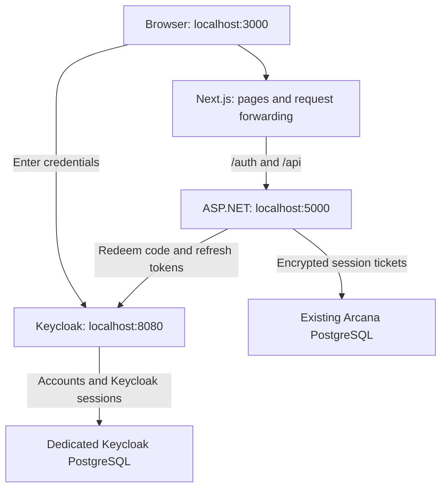
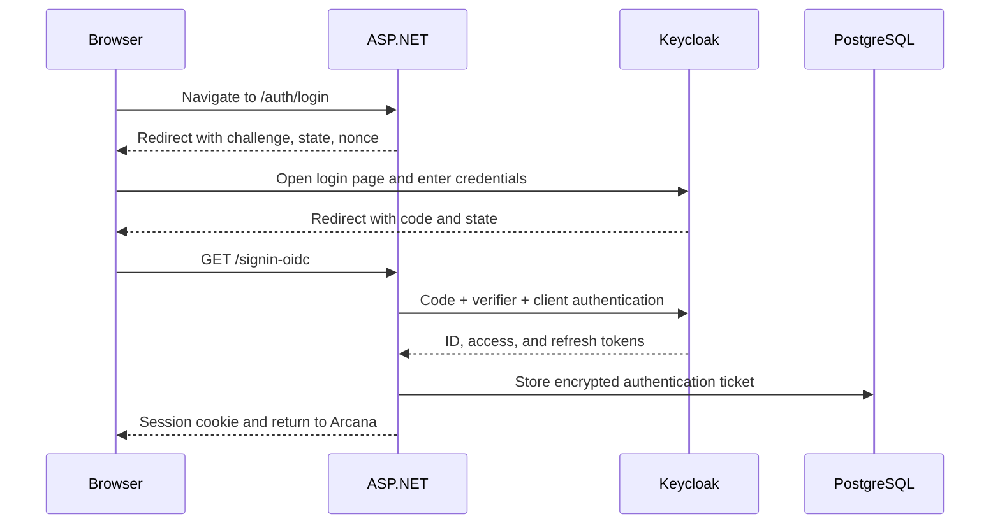
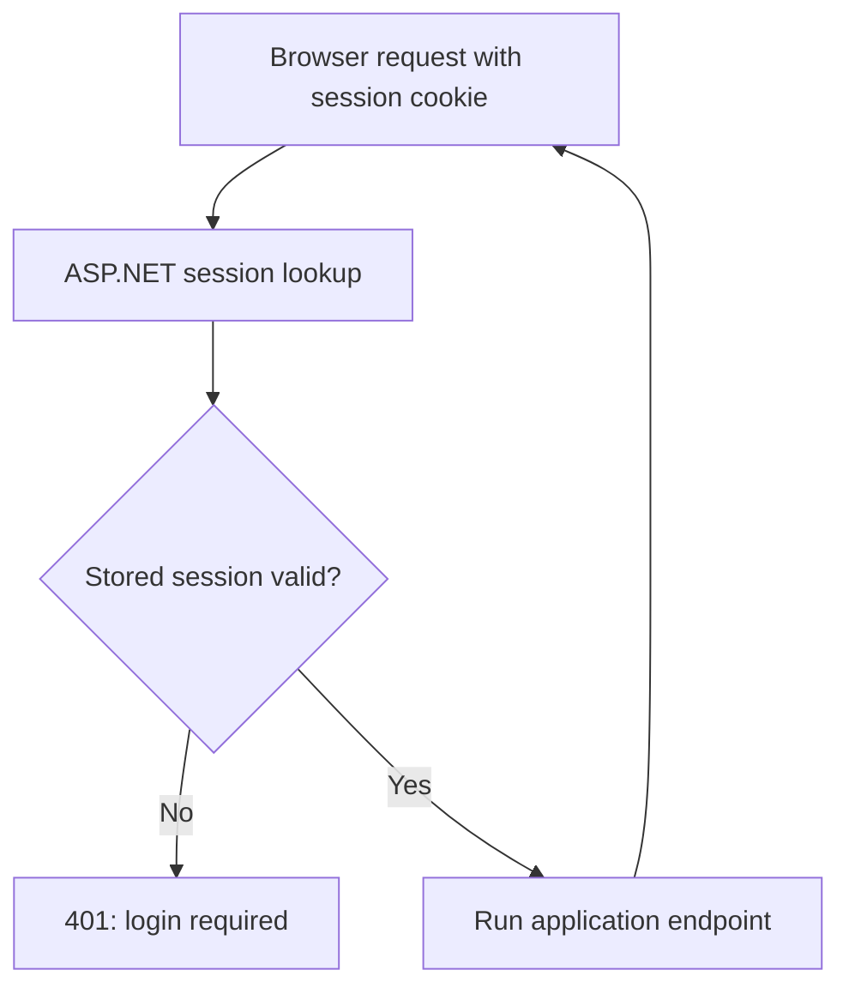

# SEC-1: understand and run the first complete login journey

**Outcome:** log in through Keycloak, return to Arcana, see the authenticated account, make cookie-authenticated requests, and log out.

**Status:** implementation prepared against commit `3bace68` from your ZIP. Browser transport tests and static configuration checks were run. The full .NET build, PostgreSQL integration tests, Next.js build, and real Keycloak round trip must still run on your machine/server; the implementation workspace has neither .NET nor Docker, and the bundled frontend dependencies are incomplete.

**Scope:** this is a development milestone. Private endpoints now require login, but logged-in users still share the existing unowned data until SEC-2. Use one development account for normal exploration. Do not deploy this version as a public multi-user application. Python authentication is SEC-3.

## How to learn from this implementation

For every checkpoint, answer four questions:

1. What visible action starts this flow?
2. Which component makes the decision?
3. What information crosses the boundary?
4. What observation proves it worked?

Read the flow first. Run the checkpoint second. Read a specific implementation file only when you want to see how that boundary is enforced. You do not need to memorize middleware APIs, serialization code, or every configuration property.

## The architecture to keep in mind



Next.js forwards a small set of paths using rewrites. It does not implement OAuth or validate tokens. ASP.NET remains the confidential client. This gives development one application origin without introducing another proxy container. A production HTTPS entry proxy is still part of SEC-4.

Python and OpenAI do not participate in login. You can complete all login checkpoints without starting either.

| Term | Meaning here |
|---|---|
| Realm | The `arcana` identity space inside Keycloak, containing its accounts and client settings |
| Client | The registered application, `arcana-web`; ASP.NET implements it |
| Client secret | A credential ASP.NET uses to authenticate itself to Keycloak; not a user's password |
| Callback | The address Keycloak sends the browser back to: `/signin-oidc` |
| Authentication ticket | ASP.NET's stored representation of the authenticated identity and tokens |
| Session cookie | A protected reference to that stored ticket; not the ticket's OAuth tokens |
| Discovery document | Keycloak's published endpoint addresses and protocol metadata |

## Checkpoint 0: apply the implementation

Prerequisites on the Linux development server: Docker with Compose, Python 3, curl, the .NET 10 SDK and EF CLI, and your existing frontend Node/npm toolchain. Node 22.18+ or 24 is needed for the optional direct-TypeScript transport tests.

The delivery ZIP contains `arcana-sec1.patch`, this walkthrough, and the verification record. Extract those files into your project root. The patch includes all new and modified source files, including this guide under `docs/SEC1.md`.

From the repository root on your Linux server:

```bash
git status --short
git apply --check arcana-sec1.patch
git apply arcana-sec1.patch
```

The first command shows whether you have other local work. The second checks compatibility without changing files. If it reports a conflict, stop and inspect it; do not force-apply it over newer work. The patch targets the uploaded ZIP, not an unseen newer branch.

After applying, the loose delivery files can be moved out of the repository; `docs/SEC1.md` is the tracked copy of the guide. Applying the patch does not commit or push anything.

Stop the old ASP.NET and Next.js processes with Ctrl+C in their terminals. If the old API is running in Docker, stop just that service:

```bash
docker compose -f backend/docker-compose.yml stop api
```

Keep the existing database volume. Do not use `down -v`. The security migration adds an authentication-session table and does not assign, remove, or change ownership of existing readings/conversations.

## Checkpoint 1: give Keycloak an identity space and a client

**Action:** create local secrets and start identity infrastructure.

```bash
python3 scripts/sec1-setup.py
bash scripts/sec1-infra.sh
```

The setup script generates three different random credentials: Keycloak's database password, its bootstrap administrator password, and ASP.NET's client secret. It stores them in an ignored local file with restrictive permissions. It preserves that file on subsequent runs.

The infrastructure script starts the existing Arcana PostgreSQL service and two additional services: Keycloak and its dedicated PostgreSQL. Existing Compose project/volume names are preserved by using the original backend Compose file as the base.

The imported realm declares:

| Setting | Value | Reason |
|---|---|---|
| Realm | `arcana` | Separate application identities from Keycloak administration |
| Client | `arcana-web` | Register ASP.NET as the application |
| Client authentication | Enabled | ASP.NET can keep a secret |
| Standard flow | Enabled | Authorization Code flow |
| PKCE | `S256` required | Bind code redemption to the initiating transaction |
| Redirect URI | `http://localhost:3000/signin-oidc` | Exact return address, no wildcard |
| Implicit / password grant | Disabled | Login uses the browser redirect/code flow |
| Registration | Enabled | Users create credentials directly in Keycloak |
| Email verification/reset | Disabled for this local milestone | SMTP has not been configured |

The realm import references an environment variable for the client secret; the committed JSON has no real secret. Keycloak supports environment substitution in realm imports. Existing realms are skipped on startup: editing the import JSON later does not automatically update an existing realm. Apply later realm changes deliberately through Keycloak configuration; do not erase its database to make configuration changes. [Keycloak import documentation](https://www.keycloak.org/server/importExport)

**Observe:** the script prints that discovery is ready. On the server, this returns JSON:

```bash
curl -fsS http://localhost:8080/realms/arcana/.well-known/openid-configuration
```

This proves Keycloak is running and knows the realm. It does not yet prove Arcana login works.

**Optional inspection:** open Keycloak's administration interface, log in as `arcana-admin` using the locally generated administrator credential, select realm `arcana`, and inspect client `arcana-web`. Use an editor to read the credential locally; do not paste the secrets file into a chat or commit it. The bootstrap administrator is not your normal Arcana user.

## Checkpoint 2: start ASP.NET and the browser entry point

**Terminal A, repository root:**

```bash
bash scripts/sec1-api.sh
```

This loads the client configuration, applies EF migrations, and runs ASP.NET on the host. Only the application authentication settings are exported to ASP.NET; Keycloak's administrator/database credentials are not exported by this script.

The added table, `authentication_sessions`, contains an encrypted ticket and expiration metadata. The ticket-store lookup key is hashed before database storage. This is an infrastructure table managed by a SQL migration; it is intentionally not a tarot domain entity or an EF model addition.

ASP.NET Data Protection keys persist in its ignored `.security-keys` directory. On Linux, the directory is restricted to the owner. Keep that directory between restarts. Losing the keys invalidates existing sessions. Production key management and encryption of the key ring itself are SEC-4 work.

**Terminal B, repository root:**

```bash
cd frontend
npm ci
cd ..
bash scripts/sec1-frontend.sh
```

The frontend uses port **3000** explicitly. If that port is occupied, fix the old process; do not let it switch to 3001 because the registered callback uses 3000.

If your browser is on your laptop while the processes run on the Linux server, forward **both 3000 and 8080**, keeping those same local ports. You can use VS Code's Ports panel, or a separate laptop terminal with your existing SSH alias:

```bash
ssh -N -L 3000:127.0.0.1:3000 -L 8080:127.0.0.1:8080 ai-server
```

This makes laptop `localhost:3000` reach server Next.js and laptop `localhost:8080` reach server Keycloak. The host-run ASP.NET process already reaches Keycloak at server `localhost:8080`. Do not replace one of these URLs with `127.0.0.1` in the browser: use the registered `localhost` addresses consistently.

**Observe:** visit [Arcana Account](http://localhost:3000/account). It should show a login button. Visiting [Current user](http://localhost:3000/auth/me) before login should return HTTP 401. The built-in spread catalogue remains public.

Development HTTP is explicitly permitted only for loopback URLs in ASP.NET's Development environment. The Keycloak service uses `start-dev` and loopback port binding. These settings are for local/SSH-tunnel development; they are not the production HTTPS deployment. [Keycloak container documentation](https://www.keycloak.org/server/containers)

## Checkpoint 3: follow one login, including the part the browser cannot see



The Next.js forwarding hop is omitted from this diagram because it does not make authentication decisions.

1. Click **Log in / Register** on the Account page.
2. On Keycloak's page, create a normal development account or log in.
3. You return to Arcana's Account page and see your account name.
4. Open `/auth/me` again: it should now return a small identity response, without tokens.

**What makes this possible:** the ASP.NET OIDC handler implements the protocol. `SecurityRegistration.cs` configures `ResponseType=code`, `UsePkce=true`, trusted issuer/client settings, cookie storage, and exact callbacks. Keycloak independently requires S256. The framework protects temporary login state and uses correlation/nonce checks; we do not implement our own cryptographic protocol.

The temporary protected `state` value travels through the browser. Protected transaction data is not the same thing as exposing a plaintext verifier. After login, the OAuth tokens remain in the encrypted server-side ticket. [ASP.NET OIDC documentation](https://learn.microsoft.com/en-us/aspnet/core/security/authentication/configure-oidc-web-authentication?view=aspnetcore-10.0)

**Observe in browser DevTools:** the authorization request should contain `response_type=code`, `code_challenge_method=S256`, `code_challenge`, `state`, and `nonce`. It should not contain `client_secret` or a plaintext `code_verifier`. The callback contains a code, not access/refresh tokens. Do not share callback URLs or cookie contents.

The code redemption request does not appear in browser DevTools: ASP.NET sends it to Keycloak from the server. Absence from the browser network panel is expected.

**One-sentence explanation you should be able to give:** “Keycloak authenticates the person, then ASP.NET proves it can redeem this particular code and establishes its own session.”

## Checkpoint 4: understand an ordinary authenticated request

Login is a special redirect journey. Loading an existing reading is an ordinary request.



The cookie is HttpOnly: browser JavaScript cannot read it, but the browser can attach it to requests. This reduces token exposure; it does not make XSS harmless because injected same-origin JavaScript could still submit requests as the user.

The request paths are intentionally separate:

| Code runs in | What it sends | Implementation |
|---|---|---|
| Browser component | Relative `/api/...` request; browser attaches cookie | `frontend/lib/api.ts` + `auth.ts` |
| Next.js server-rendered page | Internal backend request with the incoming Arcana cookie explicitly forwarded | `frontend/lib/api.server.ts` |
| Both | Same endpoint names, request bodies, and response handling | `frontend/lib/api-client.ts` |

Server-side fetch does not inherit a visitor's cookies automatically. This is why only adding `credentials` to the old helper would have been incomplete. Protected responses use no-store caching, and server-rendered requests read the current request's cookies.

**Observe:** open Readings after login and reload it. The page should still work. This proves the server-rendered path also carries the session. A logged-out request to the private API gets 401; a server-rendered private page redirects to Account.

## Checkpoint 5: understand the extra protection on a mutation

For a POST such as “Interpret with Arcana”:

1. The browser requests `/auth/csrf` using the session cookie.
2. ASP.NET returns an antiforgery request token and sets its matching cookie.
3. The frontend sends `X-CSRF-TOKEN` on the actual POST.
4. ASP.NET checks the pair before running the endpoint.

**Why:** cookies are automatically attached by browsers. The extra token helps distinguish an application request from an unwanted request induced by another site. It is not an OAuth access token. Login's `state` check protects a different transaction; it does not replace antiforgery protection on ordinary application POSTs. [ASP.NET antiforgery documentation](https://learn.microsoft.com/en-us/aspnet/core/security/anti-request-forgery?view=aspnetcore-10.0)

All existing browser mutations use this shared transport, including POSTs without a body. Read-only GET requests do not need an antiforgery token.

**Observe without spending OpenAI credit:** while logged in, use DevTools Console:

```javascript
await fetch('/auth/logout', { method: 'POST' }).then(r => r.status)
```

Expected: **400**, and you remain logged in because the antiforgery header was absent. Then use the actual Log out button for a valid protected POST.

## Checkpoint 6: expiry, refresh, and logout

| Limit | Default behavior |
|---|---|
| Arcana idle session | Expires after 30 minutes without requests |
| Arcana absolute session | Expires after 8 hours even with activity |
| Keycloak access token | 5 minutes |
| Keycloak revalidation | On the first request after 60 seconds since the previous validation |
| Expired-row cleanup | Every 15 minutes; expired sessions are rejected immediately, before cleanup |

ASP.NET uses the refresh token for bounded revalidation. Keycloak-side session invalidation is therefore not instantaneous: it is detected on a subsequent request after the configured interval. No background browser polling is required. If Keycloak rejects the refresh grant, Arcana removes the local session. If Keycloak cannot be reached, that request fails unauthenticated, while the stored session is retained for a later retry.

Keycloak rotates refresh tokens. A PostgreSQL row lock means two simultaneous page requests do not both try to use the same old refresh token. The cookie itself has a fixed absolute expiration; refreshing the server-side ticket does not require a Next.js Server Component to forward a new Set-Cookie response.

Click **Log out**. ASP.NET deletes the local session and clears its cookie, then the browser navigates to Keycloak logout. Keycloak may ask for confirmation: this implementation uses `client_id` and the registered redirect instead of exposing the ID token in a logout URL. Complete that confirmation to end Keycloak SSO too. If Keycloak is unavailable, Arcana's local session still ends; the provider's separate session may remain until expiry or a later successful logout. [Keycloak logout endpoints](https://www.keycloak.org/securing-apps/oidc-layers)

**Observe:** `/auth/me` now returns 401. Logging in again works. After restarting ASP.NET with the same database and key directory, an unexpired session should still work. Deleting a database session invalidates its cookie immediately.

## Where the important decisions live

Paths below are repository-relative.

| File | Read it to understand |
|---|---|
| `backend/keycloak/arcana-realm.json` | What Keycloak permits for the client |
| `backend/Tarot.Api/Security/SecurityRegistration.cs` | How ASP.NET joins OIDC and cookie authentication |
| `backend/Tarot.Api/Endpoints/AuthEndpoints.cs` | Login, current user, CSRF token, and logout entry points |
| `backend/Tarot.Api/Security/PostgresTicketStore.cs` | Server-side sessions, expiry, synchronized refresh |
| `backend/Tarot.Api/Security/KeycloakTokenRefresher.cs` | Server-to-server token refresh |
| `backend/Tarot.Api/Security/BrowserSecurityMiddleware.cs` | Antiforgery checks before application mutations |
| `frontend/next.config.ts` | Which URLs are forwarded to ASP.NET |
| `frontend/lib/auth.ts` | Browser session and antiforgery requests |
| `frontend/lib/api.server.ts` | Cookie forwarding during server rendering |

The security bypass in the existing integration-test factory is restricted to the `Testing` environment so older domain/API tests retain their original purpose. New `Sec1EndpointTests` run with real security enabled and use a test-only sign-in middleware. No test login route is registered by production application code.

## Verification commands and what they prove

After loading the configuration through the API script and checking the real login journey, run:

```bash
dotnet test backend/Tarot.IntegrationTests --filter FullyQualifiedName~Sec1EndpointTests
```

These tests use disposable PostgreSQL and stub the identity provider. They check unauthenticated rejection, public catalogue access, PKCE challenge generation, tampered callback rejection, encrypted ticket storage, antiforgery enforcement, replay after logout, and concurrent refresh. They do not replace the real Keycloak login check.

The frontend transport checks require Node 22.18+ or Node 24 because they run TypeScript directly:

```bash
node --test frontend/tests/security-transport.test.mjs
```

On your normal frontend toolchain, also run `npm run build` from `frontend`. The implementation workspace could parse the TypeScript transport and run its three tests, but could not build Next.js from the incomplete dependency files in the uploaded ZIP.

For a controlled negative PKCE check, log out, start a fresh login, and change one character of the `code_challenge` in the initial Keycloak authorization URL while leaving state/nonce unchanged. Finish that login in your own development environment. ASP.NET still submits its original verifier, so Keycloak should reject code redemption and Arcana should show a login error. Start a fresh unmodified login afterward. Merely omitting the client secret in a curl request would test client authentication, not PKCE.

## If a checkpoint fails

| Symptom | First thing to inspect |
|---|---|
| Invalid redirect URI | Browser must use localhost:3000; check registered callback and actual frontend port |
| Browser cannot open Keycloak | Forward 8080 as well as 3000 from the remote server |
| Invalid client credentials | Preserve the generated secrets file; remember realm imports are skipped when the realm exists |
| Invalid Security configuration | Start ASP.NET through `sec1-api.sh` so configuration is loaded |
| Session table missing | Check that `dotnet ef database update` succeeded against the existing Arcana database |
| 401 after about a minute | Inspect Keycloak availability and client configuration; server-side revalidation is now required |
| POST gets 400 | Inspect `X-CSRF-TOKEN` and use the frontend request wrapper |
| New changes not picked up | Restart the old frontend/API processes; verify the fixed ports |

Do not solve authentication errors by disabling issuer checks, enabling arbitrary redirects, or putting a client secret in frontend configuration. The next architectural step, SEC-2, uses the now-established identity to enforce resource ownership.
