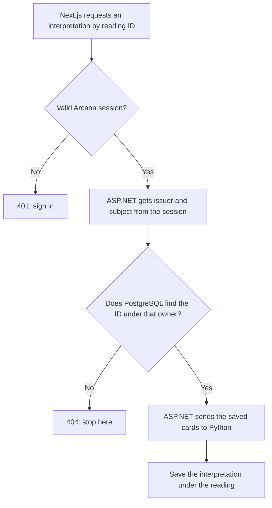

# SEC2 · A private history for each Arcana account

**Start with a small experiment.** Ana and Ben can both sign in. Ana creates a reading and copies its address. Ben opens that same address. What should happen? Signing in proves that Ben is Ben. It does not give him permission to read Ana’s question, her cards, or the conversation she had about them. SEC2 makes the API answer “not found” for Ben, while Ana can still open the same reading.

## Follow one request: “interpret this reading”



SEC1 established who is calling. For a browser POST, its antiforgery check also still applies. SEC2 adds the decision at the database lookup. The browser sends the reading ID; it does **not** select which user's records to search. There is no new login prompt, Keycloak role or token exchange. The AI never needs to decide who owns a reading or draw replacement cards.

**Issuer** identifies the Keycloak realm that vouched for the user. **Subject** (the `sub` claim) identifies the account within that realm. Together they form the ownership key. ASP.NET reads it from the authenticated session, never from an email address, request body or URL. Changing a display name does not transfer data. Changing the issuer URL, even the port, changes the ownership key: keep the working issuer stable or explicitly plan a verified identity migration.

## What lives where?

| Data | How Arcana decides who may use it |
| --- | --- |
| Reading, including a custom spread snapshot | ASP.NET stamps the owner on the reading when saving the card draw. |
| Cards, interpretations, reflection questions | They belong to the reading. Even a direct interpretation lookup checks the parent reading’s owner. |
| Talk to Arcana conversation and messages | A conversation has an owner even before a reading exists. Messages are loaded or appended through that conversation. |
| Reading/conversation/interpretation links | Referenced context is looked up under the caller before it is used for AI; the repositories also check the linked parents when saving. |
| Built-in spread catalogue and RAG knowledge | Shared reference material. A card meaning is common knowledge; someone’s question about that card is private. |

To picture the database check, read this as: **find the specific reading, in the current user's history**.

```sql
SELECT id FROM readings
WHERE id = @reading_id AND owner_issuer = @issuer AND owner_subject = @subject;
```

The real repositories use EF Core to construct parameterized queries. The owner filter also runs **before counting, sorting and taking a page**. Otherwise a page could contain only Ana’s items while its total still revealed how much activity everyone else had.

## Code tour: four stops

1. **Identity:** `backend/Tarot.Api/Security/SecurityRegistration.cs` derives one request-scoped owner from the authenticated principal. The fallback policy requires a usable subject from the configured issuer for private domain routes.
2. **Rule:** `backend/Tarot.Infrastructure/Persistence/ResourceOwner.cs` defines the owner and three `OwnedBy` queries. Open the interpretation overload: following `i.Reading` makes it unnecessary to copy identity to every interpretation.
3. **Enforcement:** in `backend/Tarot.Infrastructure/Persistence/Repositories/`, follow `PostgresReadingRepository.GetPageAsync` from `OwnedBy` to `CountAsync`. Next, follow `PostgresConversationRepository.AppendExchangeAsync`: it must find an owned conversation before adding either message. A new repository for private data must use the same rule. This is application authorization, not a PostgreSQL row-level-security policy.
4. **Evidence:** `backend/Tarot.IntegrationTests/Security/Sec2OwnershipTests.cs` uses two independent session cookies, the real API and a disposable PostgreSQL database. It substitutes test responders for AI so the test can check that denied requests never call the interpreter or chat responder. SEC1 tests separately exercise anonymous requests, CSRF and sessions.

## Apply on your development VM

The patch is relative to the project root and was prepared against SEC1 commit `2854953`. Start with your existing SEC1 work committed. Extract the ZIP into `~/Downloads/arcana-sec2`, or adjust the path below.

```bash
cd ~/projects/arcana-ai
git status --short
git switch -c sec2-resource-ownership
git apply --check ~/Downloads/arcana-sec2/arcana-sec2.patch
git apply ~/Downloads/arcana-sec2/arcana-sec2.patch
dotnet test backend/Tarot.slnx
```

If the check reports a conflict, stop before applying and compare your local changes; do not force the patch. Tests need .NET 10 and a working Docker daemon. The integration tests create their own PostgreSQL container; they do not need your Keycloak admin password, your development database, or an OpenAI key. Run just this milestone with `dotnet test backend/Tarot.IntegrationTests --filter FullyQualifiedName~Sec2OwnershipTests`.

**Before upgrading your own database:** Stop any running SEC1 API, including any old container serving it. Keep the development database running. Make a private backup outside the repository, confirm the command succeeds, then start the stack as usual:

```bash
umask 077
mkdir -p ~/arcana-backups
docker exec arcana-ai-postgres pg_dump -U arcana_user -d arcana_ai -Fc > ~/arcana-backups/pre-sec2-$(date +%Y%m%d-%H%M%S).dump
# Run only after the backup and tests succeed.
bash scripts/run-dev.sh
```

The existing API launcher applies `20261111120000_AddResourceOwnership` and starts ASP.NET. No new Compose file, admin account, port, script or secret is needed. Keep Keycloak on your working port 8081.

**Why does an existing account now see an empty history?** SEC1 did not record who made older readings and conversations, even if someone was signed in. The migration leaves their owner columns null. Their data stays in PostgreSQL, but no app user matches those rows. Do not assign old rows to the first user who logs in. Recovery needs independent evidence of ownership and a separately reviewed migration covering linked records. The Down migration drops ownership information; rolling back to the unfiltered SEC1 API would undo privacy. Use a separate restored development database for rollback experiments.

## Prove it in the browser

Use two disposable Arcana realm accounts. Use a normal browser window for Ana and a private window for Ben so they do not share a cookie. Use the application at `http://localhost:3000` and the existing sign-in button.

| Try this | Expected observation |
| --- | --- |
| As Ana, create a reading and open it. | Her own history lists it. Save the reading ID. |
| As Ben, create a different reading. | His list and total contain only his own new reading. |
| Open `/api/readings/<Ana-reading-ID>` through localhost:3000 in each window (substitute the real ID). | Ana gets the reading and cards. Ben gets HTTP 404. Check the Network panel for the API status; a rendered Next.js page can have a different status. |
| As Ana, start a conversation and ask for an interpretation. | Her app can still use the linked data; Ben's conversation history does not change. The live AI service must be running for this step. |
| Log out and refresh the private API URL. | HTTP 401. Arcana needs a session before it even looks for the reading. |

**Interview answer:** “I used Keycloak to establish identity, then enforced ownership in the ASP.NET backend. A logged-in user can ask for any ID, so the repository checks both the ID and the account from the session. I test with two valid users, including nested data and AI actions, because a logged-out test alone cannot prove account isolation.”

**Boundary of this milestone:** this secures the application’s private resource routes. Direct database access and service-to-service authentication are separate trust boundaries. Token exchange is not needed for SEC2. For the authorization principle behind the design see the [OWASP Authorization Cheat Sheet](https://cheatsheetseries.owasp.org/cheatsheets/Authorization_Cheat_Sheet.html).
