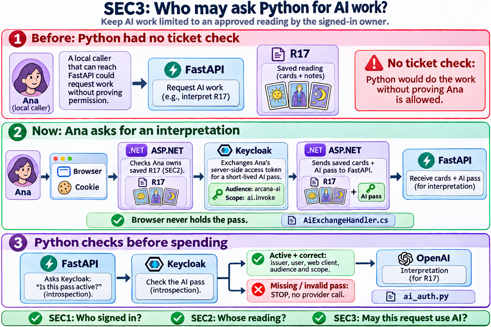

# SEC3 · A ticket for the AI service

Imagine Ana presses **Interpret** on her saved reading R17. Her browser knows she has an Arcana session. Python is a separate program: receiving a request on port 8000 does not establish who approved it. SEC3 gives Python evidence it can verify before spending money on an OpenAI call.

The accompanying SEC3 PNG shows this specific reading example. For a general chat or a standalone spread recommendation there need not be a reading. The same AI permission is required.

| Milestone | Question | Who answers? |
| --- | --- | --- |
| SEC1: login | Who signed in? | Keycloak verifies credentials; ASP.NET establishes a session. |
| SEC2: ownership | May this person use reading R17? | ASP.NET queries PostgreSQL under the session owner. |
| SEC3: delegated AI work | Is there a valid user access token intended for this AI service? | Keycloak issues the token; FastAPI checks it before running AI. |

## Follow Ana's click

1. The browser sends its existing cookie. ASP.NET loads R17 under Ana’s identity. Ben asking for Ana’s R17 still gets a 404 before token exchange.
2. **Token exchange:** ASP.NET authenticates as the existing confidential client, arcana-web. It sends the user's server-side **access token** to Keycloak and requests another access token: audience **arcana-ai** (the recipient), scope **ai.invoke** (the permission). It does not use the user's password, refresh token, or ID token for exchange. One exchange per outbound AI request; no shared token cache.
3. ASP.NET sends the saved cards and the new bearer token to FastAPI. A bearer token is like a ticket that whoever holds it can present. The browser never gets the AI token. The token authorizes the service call; it does not list authorized reading IDs or prove ownership of R17.
4. **Introspection:** Python authenticates as the separate arcana-ai client and asks Keycloak about the token. The answer must say active, unexpired, bearer access token, correct issuer, nonempty user subject, intended audience, issuing/requesting client arcana-web (azp), and ai.invoke scope. Missing token: 401. Inactive token: 401. Active token with insufficient permission: 403. Verification unavailable: 503. No fallback to anonymous AI.
5. Python runs the existing workflow. It can retrieve shared tarot knowledge and call OpenAI with its existing provider key. The Keycloak token is never forwarded to OpenAI. Cards are still drawn and saved by C#.

## Where the change lives

- backend/Tarot.Api/Security/AiExchangeHandler.cs — the outgoing request handler. Reads the current session, performs the exchange, attaches Authorization for this request only.
- backend/Tarot.Api/Program.cs — all three Python HTTP clients use that handler. Neither exchange nor AI requests follow redirects or share a cookie jar.
- ai-service/app/ai_auth.py — FastAPI permission check, with a fixed recipient and caller and bounded introspection timeout. Does not trust claims from the browser.
- ai-service/app/main.py — groups the three private AI routes behind the check. GET /health remains public for the launcher.
- scripts/sec3-keycloak.py — one-time VM configuration for a new OR existing SEC1 realm. No database migration, realm deletion, replacement user, or change of port.
- Tests: backend/Tarot.IntegrationTests/Security/Sec3ExchangeTests.cs and ai-service/tests/test_ai_auth.py, test_sec3_routes.py.

## Apply on the VM

Start from the working SEC2 checkout. Keep local edits committed separately. Extract the ZIP outside the repo, for example into ~/Downloads/arcana-sec3. The patch adds this file under docs. If the check fails, stop and compare the differing files rather than forcing it.

    cd ~/projects/arcana-ai
    git apply --check ~/Downloads/arcana-sec3/arcana-sec3.patch && git apply ~/Downloads/arcana-sec3/arcana-sec3.patch
    cp ~/Downloads/arcana-sec3/SEC3-flow.png docs/SEC3-flow.png

Run the tests from the project root:

    dotnet test backend/Tarot.slnx
    (cd ai-service && uv run --frozen pytest)

## Configure the existing Keycloak, once

Leave the working Keycloak container up. If it is down, first run bash scripts/sec1-infra.sh. From the project root:

    python3 scripts/sec3-keycloak.py

Enter your **master-realm administrator** credentials in the VM terminal prompt, not your Arcana user password. This setup helper uses master/admin-cli only on loopback; it assumes that CLI password authentication is available for your development admin. It does not enable password grants for either application client. If your admin uses MFA or the CLI grant is disabled, use an authorized admin console session to make the equivalent settings below; do not weaken admin login.

The helper keeps users, the existing web secret and existing AI settings. It enables standard token exchange on arcana-web, attaches basic as a default scope for subject identity, creates a confidential arcana-ai client for introspection (no login flows or service accounts), and creates an **optional** client scope ai.invoke on arcana-web. That scope includes an Audience mapper for arcana-ai with access-token and introspection inclusion enabled and ID-token inclusion disabled. Include the scope name in the token scope. The audience parameter filters eligible audiences; the mapper is what makes this audience eligible. The helper provisions live configuration because realm import at startup does not update an existing realm.

It writes AI_AUTH_ISSUER and AI_INTROSPECTION_SECRET into the existing ai-service/.env with owner-only permissions. For manual setup use the same values: issuer http://localhost:8081/realms/arcana and the **arcana-ai** client credential (not arcana-web's credential). Never commit .env. A rerun reuses the managed client, including its existing secret. It refuses conflicting unmanaged client or scope names.

With the existing Docker launcher:

    bash scripts/arcana.sh up

This rebuilds code and reloads the AI environment. For host development restart run-dev.sh instead; don't run both launchers. Sign out/in once for a fresh web session. Your earlier “Invalid username or password” happens before SEC3: configure with an admin if available, and use a working ordinary Arcana account for the positive test. SEC3 is not a password fix.

## Observe both sides

1. On the VM, read the health route: curl -i http://127.0.0.1:8000/health — expect 200.
2. Without a login or tokens, run: curl -i -X POST http://127.0.0.1:8000/interpretations -H 'Content-Type: application/json' -d '{}' — expect 401. This does not call OpenAI.
3. In the browser, sign in, create a new reading and click Interpret. Expect an interpretation to be saved on your own reading. This uses your configured OpenAI account. Chat and spread recommendation pass through the same guard.
4. If the public health route succeeds but AI does not: check that the one-time helper succeeded, both app services were rebuilt, and there is a fresh signed-in session. If exchange is denied, check arcana-web's Standard token exchange switch and optional scope assignment. If verification is unavailable, check Keycloak reachability and the AI client secret. Do not paste tokens or full callback URLs. A private Python authorization failure may appear as a provider error through the existing public API; it is not necessarily a bad Arcana password.

## Why this design?

An API key shared by ASP.NET and Python would be simpler, but identical for all users. Client credentials would suit a background job with no human involved. Here the action is on behalf of a signed-in person, so a short-lived delegated token is useful. Introspection is straightforward and checks current active status, at the cost of a second Keycloak round trip per AI request and a new receiver credential. Local signature verification with cached public keys would reduce that dependency.

This is a bearer-token boundary, not mutual TLS or a per-reading signature. A stolen valid AI token can be replayed while active. Use loopback HTTP only on the private development VM; use HTTPS for real deployments. Identity, permissions and audience are checked before AI; object ownership still belongs exclusively to ASP.NET. Requests cannot succeed if Keycloak is unavailable.

Interview version: “ASP.NET authorizes access to the user's reading. It then asks Keycloak for an access token specifically for the AI service. Python verifies that pass before doing any AI work. This lets Python trust the delegated permission without receiving the browser cookie, original login token or user password.”

References: [Keycloak standard token exchange](https://www.keycloak.org/securing-apps/token-exchange), [Keycloak introspection](https://www.keycloak.org/securing-apps/oidc-layers).
